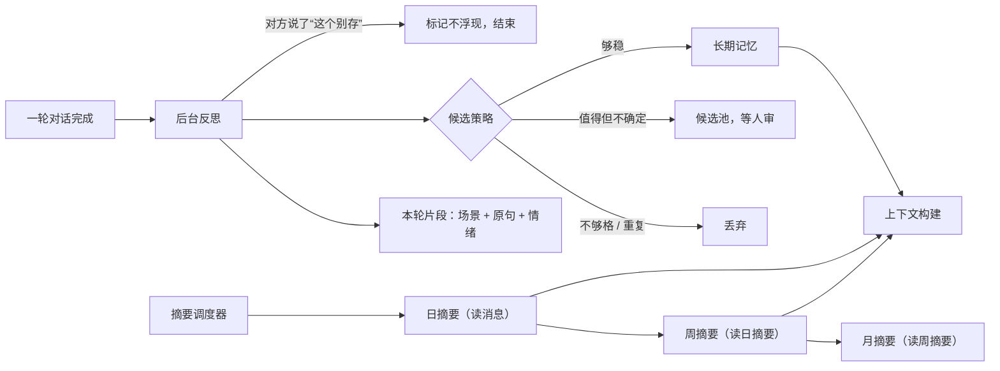

# 记忆写入流水线：反思与分层摘要

> 对应代码：`src/persona_hub/memory_reflection.py`、`src/persona_hub/memory_summaries.py`。召回那一半（常驻保留区、七路混合打分、情绪维度）见 `memory.py` 和 [architecture.md §11](architecture.md)。

召回决定“想起什么”，写入决定“有什么可想”。写入做坏了，召回再聪明也只能从一堆套话里挑。这两部分是私人部署里改得最多的地方，下面每条规则背后都有一次事故。

## 1. 全景



反思在回复送达之后才在后台跑，不拖慢、也不会弄挂这一轮聊天。

## 2. 反思

### 2.1 喂进去什么

- 这一轮的用户消息和回复；
- **前面四轮对话**。真实聊天跳得厉害，“那个弄好了吗”脱离上文根本没法理解，模型只能退回抽象转述，这正是摘要变成公文腔的一半原因。前文只用来理解指代，不重复提取；
- 两个人的名字。输出一律写名字，不写“用户”“助手”“AI”。

### 2.2 打分要有锚点

没有锚点时，模型给每条候选都打 0.95，长期记忆库很快被普通的甜言蜜语和闲聊淹没。现在的锚点：

| 分数 | 适用 |
|---|---|
| 0.90 以上 | 身份、边界、承诺、关系转折、明确且长期的事实。很多轮对话一条都没有 |
| 0.70–0.85 | 稳定偏好、正在做的事、具体计划、明确的健康或安全信息 |
| 0.50–0.65 | 可能有用但还不确定的线索 |
| 0.50 以下或不输出 | 普通爱意表达、日常调情、一般安慰、临时情绪 |

并且明确告诉模型：**这一轮没有值得记的，就返回空数组，这是正确且常见的结果。**

### 2.3 类别要如实

放任不管的话，模型会把几乎所有东西都塞进 `emotion`。客观信息归 fact，喜好归 preference，做过的事和技术进展归 worklog，关系设定和称呼归 relationship，具体安排归 plan；只有情绪本身就是内容时才用 emotion。每轮每个类别最多一条。

`worklog` 在召回打分里的先验分最低（0.40）。私人部署有一周新增了 210 条记忆，其中 207 条是工作日志，真正从对话里反思出来的只有 3 条。

### 2.4 不许公文腔

摘要里禁用“进行了、表达了、确认了、给予”这类动词，直接写谁说了什么、谁做了什么。

- 反例：双方进行了深度情感确认。
- 正例：她说今天好长，他说回来吧，我做饭。

强情绪的短句原样进 quotes，一个字都不改。温度用 0.4：0.1 会把“她说想他”压成“表达了思念”，而 JSON 结构由 JSON 模式保证，升温不会让格式跑散。

### 2.5 候选去哪

`CandidatePolicy` 的阈值是数据，可以调。默认值等于私人部署现在的行为：

| 类别 | 直接记住 | 进候选池 |
|---|---|---|
| quote | 分数 ≥ 0.97 且重要度 ≥ 8 | ≥ 0.96 |
| emotion | ≥ 0.96 且重要度 ≥ 7 | ≥ 0.95 |
| relationship | ≥ 0.95 且重要度 ≥ 8 | ≥ 0.94 |
| fact / preference / identity / habit / work | ≥ 0.82 | ≥ 0.93 |
| plan | ≥ 0.90 且重要度 ≥ 7 | ≥ 0.93 |

在这之前还有两道筛：分数低于 0.55、去掉标点后不到 8 个字、纯语气词或纯称呼，直接丢；和最近 30 天同类记忆或待审候选的文字重合度超过 0.85，当重复丢。

有一点要说清楚：按默认阈值，一条 0.82 到 0.93 之间的稳定事实会被直接记住，而 0.55 到 0.82 之间的会被丢掉，不会进候选池。所以候选池大多数时候是空的。这是生产现状，写在这里，不藏。想让人审得多一点，把“进候选池”的线调低即可。

候选池接口：`GET /api/memory/candidates`、`POST /api/memory/candidates/{id}/accept`、`POST /api/memory/candidates/{id}/reject`。

### 2.6 “这个别存”

只有对方明确说“这个别存”“别记这个”“don't save this”时，这一轮才会被标记为不浮现。**亲密或露骨的内容本身绝不是隐藏的理由。**

标记不浮现等于不再进入任何后续 prompt（摘要、欲望系统的近期聊天），但消息本身不删。禁止浮现不等于销毁证据。这一步不需要模型，没配反思模型时也照样生效。

### 2.7 开源版多走的一步

本轮反思产出的记忆会继承这一轮片段的情绪坐标（valence / arousal）。私人部署的候选记忆不带情绪坐标；开源版的召回有情绪维度，没有坐标的记忆在这一维上只能拿中性分，所以这里补上了。

## 3. 分层摘要

### 3.1 表单决定内容

摘要原先的结构只有 `{summary, tags}`。模型再好，也只能写出干巴巴的叙述，因为表单上根本没有放情感的栏。现在每条摘要旁边带三层：

- **quotes**：原样保留的原句，尤其是短的、带称呼的、情绪重的；
- **scene**：情境锚点，一两句，大致什么时候、在做什么、状态怎样；
- **valence / arousal**：这段时间的情绪基调和强度。

这段摘要是写给未来的自己看的，目标是让他想起当时是什么感觉，而不是让他知道发生过哪些事。

### 3.2 没有调度器就没有摘要

私人部署有整整两个月一条日摘要都没写，因为摘要线只有一个手动接口，从来没人去调。现在的调度器：

- 启动后先等 3 分钟，让启动、工具预热和第一轮聊天先走；之后每 6 小时一轮；
- **严格按日、周、月的顺序串行执行**：周摘要读日摘要，月摘要读周摘要，并发会读到空的；
- **只补已经结束的周期**：今天、本周、本月还没过完，就等它完整再写；
- 每轮往回看 10 / 35 / 120 天，已经有的周期直接跳过，所以窗口开大一点只是多几次查询，不会重复调用模型。

手动补写：`POST /api/memory/summaries/run`，`force: true` 会覆盖重写。

### 3.3 一天按当地时间切

消息存的是 UTC。按 UTC 午夜切日，东八区的一个晚上会被切成两半。周期按 `PERSONA_HUB_TIMEZONE` 的当地时间切，再以 UTC 字符串存储，保证和 `created_at` 的字符串比较依然成立。

喂给摘要模型的时间也先换成当地时间。模型会把 UTC 当成本地时间读，于是场景里的“下午”“深夜”整体偏了八小时。锚点的时间错了，锚点就废了。

### 3.4 失败要留下原因

超时异常的 `str()` 是空字符串，只记它，错误栏就是一片空白，等于没记录。错误一律带异常类型名。另外摘要的输出比较长，要给够 token；被截断的 JSON 会让一整天的摘要直接丢失，所以提示词里写明“宁可少写几条原句，也不能写到一半被截断”。

### 3.5 敏感内容

这段时间如果有不该被随口再提起的内容，模型照实写进摘要，并打上 `sensitive` 标签。上下文构建时会跳过带这个标签的摘要：记录还在，但不会主动塞进每一轮 prompt。私人部署目前只打标签、还没在下游用它，开源版先走了这一步。

## 4. 上下文里出现什么

每轮对话的动态区按顺序是：会话滚动摘要 → 最近一条周摘要和两条日摘要（不含敏感的，带场景和原句）→ 召回的记忆。

凭据可以留在历史存储里供审计和恢复，但绝不能出现在 prompt 里。`redact_credentials` 在所有“存储文字变成 prompt 文字”的边界上过滤 Bearer 头、`api_key=...`、`sk-...` 和私钥块。

## 5. 配置

```dotenv
PERSONA_HUB_TIMEZONE=+08:00            # 或 IANA 名称，如 Asia/Tokyo
PERSONA_HUB_USER_NAME=user             # 换成你们自己的名字
PERSONA_HUB_ASSISTANT_NAME=char
PERSONA_HUB_MEMORY_MODEL=replace-with-a-cheap-json-capable-model
PERSONA_HUB_MEMORY_REFLECTION=1        # 每轮后台反思
PERSONA_HUB_MEMORY_SUMMARIES=1         # 摘要调度器
```

记忆模型复用 `OPENAI_COMPATIBLE_BASE_URL` 和 `OPENAI_COMPATIBLE_API_KEY`，模型名单独配。这些都是后台任务，不在聊天的关键路径上，用便宜一点的模型就够了。

## 6. 开源版没有的

- 纪念日和日期事件提取、人格自我笔记、历史聊天批量导入；
- 用 embedding 判重（私人部署先比 embedding，失败再退回文字重合度；这里只用文字重合度，结果是确定的）；
- 长会话的上下文压缩；
- 和 Ombre Brain 的双向桥接。
